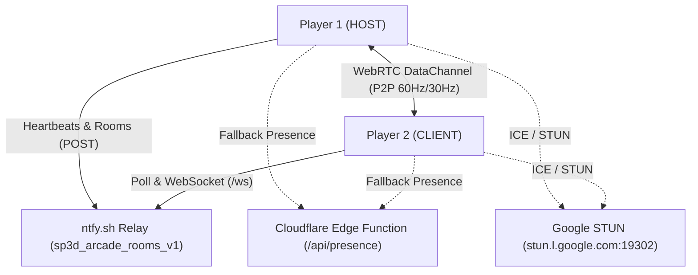

# Project Handoff: Spin Pong 3D & Curve Battle (for Claude)

> **Repository**: [https://github.com/bokk3/pong](https://github.com/bokk3/pong)  
> **Live URL**: [https://pong-ay5.pages.dev/](https://pong-ay5.pages.dev/)  
> **Current Version**: `v1.2.7`  
> **Target Platform**: Desktop & Mobile Web (cross-browser, responsive, touch + mouse + keyboard + webcam)  
> **Budget / Hosting Constraints**: **$0 / month** continuous operating cost on Cloudflare Pages (Serverless / Static).

---

## 1. Executive Summary & Architecture

Spin Pong 3D is a production-ready, client-side 3D arcade sports game featuring:
1. **Spin Pong 3D**: Full 3D table tennis simulation built in **Three.js** with realistic aerodynamic Magnus effect physics (topspin, backspin, sidespin), procedural audio, dynamic camera shakes, spectator audience in bleachers, and support for mouse, keyboard, touch gestures, and webcam computer vision (hand tracking).
2. **Curve Battle**: An integrated retro 2D top-down game mode inspired by *Achtung die Kurve* / *Curve Fever*. Players steer continuous colored ribbons leaving impassable wall trails with periodic gap jumps, competing for survival in a 4.8m x 4.8m arena.
3. **Multiplayer System**: Serverless peer-to-peer multiplayer powered by **PeerJS** (WebRTC DataChannels) with Google & Twilio STUN servers. Features quick matchmaking, private friend room codes (5-letter alphanumeric), and a global public lobby with live room discovery via an open pub/sub relay (`ntfy.sh`) and fallback Cloudflare Pages Functions (`/api/presence`).



---

## 2. Tech Stack & Tooling

| Layer | Technologies |
|---|---|
| **Core Framework** | Vanilla TypeScript (`strict: true`, no `any`) + Vite 6 |
| **3D Rendering** | Three.js (`^0.170.0`) with WebGLRenderer, custom geometries, procedural shaders |
| **Networking** | PeerJS (`^1.5.5`) for WebRTC DataChannels + native WebSockets + Fetch API |
| **Audio** | Web Audio API procedural sound synthesis (no external MP3/WAV assets) in `SoundEngine.ts` |
| **Vision / Input** | MediaDevices `getUserMedia` webcam stream with canvas luminosity / color tracking in `WebcamController.ts` |
| **Hosting & CI/CD** | Cloudflare Pages automatic builds triggered on Git push to `main` (`tsc && vite build` -> `dist/`) |
| **Package Manager** | `npm` |

### Key NPM Scripts:
- `npm run dev` - Starts local Vite dev server with custom development presence middleware (`vite.config.ts`)
- `npm run build` - Typechecks with `tsc` and bundles production assets into `dist/`
- `npm run preview` - Previews production build locally

---

## 3. Codebase File Structure & Module Directory

```
pong/
├── functions/
│   └── api/
│       └── presence.ts           # Cloudflare Pages Function: edge presence/room cache fallback
├── public/
│   ├── _headers                  # Cloudflare security headers (CSP, X-Frame-Options, HSTS)
│   ├── favicon.svg / icon.png    # Game icons and metadata
│   └── logo.png                  # Main menu arcade logo
├── src/
│   ├── audio/
│   │   └── SoundEngine.ts        # Web Audio API: procedural paddle hits, bounces, whistles, cheers
│   ├── controllers/
│   │   ├── AIController.ts       # Pong AI Bot: trajectory tracking, proactive baseline stepping, difficulty scaling
│   │   ├── CurveController.ts    # Curve Battle Snake: kinematic arc simulation, survival gating, gap generation
│   │   ├── PlayerController.ts   # Player input: mouse flick, keyboard (Space/J/K/L), swipe, touch gestures
│   │   ├── RemotePlayerController.ts # Remote opponent paddle interpolation in P2P multiplayer
│   │   └── WebcamController.ts   # Computer vision webcam motion and swipe detection
│   ├── core/
│   │   ├── CurveGameMode.ts      # Curve Battle round management, scoring, collision checks, network sync
│   │   ├── EventBus.ts           # Strongly typed singleton event broker
│   │   ├── Game.ts               # Main loop orchestrator, Three.js render loop, mode switching, network dispatch
│   │   └── StateMachine.ts       # Pong scoring rules, double-bounce detection, serve fault rules, aces
│   ├── entities/
│   │   ├── Ball.ts               # Ball mesh, shadow projection, trail binding
│   │   ├── CurveTrail.ts         # Instanced ribbon mesh for Curve Battle trails
│   │   ├── Paddle.ts             # 3D paddle mesh (blade, red/black rubbers, handle, hand) & swing animations
│   │   ├── Stadium.ts            # Stadium environment, wooden floor, bleachers, animated spectator crowd
│   │   └── Table.ts              # ITTF regulation table mesh, net tape, white boundary lines
│   ├── network/
│   │   ├── NetworkManager.ts     # PeerJS singleton, ntfy.sh global room pubsub, STUN, latency heartbeats
│   │   └── NetworkProtocol.ts    # P2P packet schemas (HANDSHAKE, PADDLE_MOVE, BALL_HIT, BALL_SYNC, CURVE_*)
│   ├── physics/
│   │   ├── BallPhysics.ts        # Substep integrator: Magnus effect, air drag, table restitution & spin kick
│   │   ├── Constants.ts          # Physical constants, table dimensions (2.74x1.525m), paddle reach limits
│   │   └── TrajectoryPredictor.ts# Multi-bounce trajectory solver for AI anticipation and launch velocities
│   ├── ui/
│   │   └── HUD.ts                # Scoreboard, menus, lobby browser, presence counter, settings dropdown
│   ├── utils/
│   │   └── DeviceDetector.ts     # Touch, mobile, orientation, and browser capability detector
│   ├── vfx/
│   │   ├── CameraController.ts   # Dynamic 3D camera with FOV punch, shake, and top-down Curve perspective
│   │   └── VFXManager.ts         # Sparks, trail ribbons, hit rings, bounce ripples
│   ├── main.ts                   # App entrypoint, canvas attachment
│   ├── styles.css                # Arcade glassmorphic UI stylesheet
│   └── types.ts                  # Shared TypeScript interfaces, types, and event definitions
├── index.html                    # Root HTML markup, UI overlays, HUD, lobby modal, settings
├── tsconfig.json                 # TypeScript compiler options (strict, ESNext)
└── vite.config.ts                # Vite config with dev presence middleware
```

---

## 4. Current State & Recent Changelog (v1.2.5 – v1.2.7)

### ✅ What Was Fixed & Is Fully Working:
1. **Pong Ball Physics (v1.2.5)**:
   - Raised `TABLE_FRICTION_XZ` from `0.82` to `0.95`. Ball retains forward momentum across bounces without dying on the table.
   - Enforced minimum bounce velocity ($v_y \ge 1.65\text{ m/s}$) and forward momentum ($|v_z| \ge 3.8\text{ m/s}$) on baseline-bound bounces.
   - Balls cleanly clear the table end into paddle reach without triggering illegal 2nd bounce faults.
2. **Pong AI Serve Whiff (v1.2.5)**:
   - Fixed `TrajectoryPredictor.predictLanding()` which previously cut off after the first bounce, plunging the AI paddle to the floor. Now handles multi-bounce anticipation.
   - Allowed AI to strike from $Z \le -0.85\text{m}$ to $-2.45\text{m}$ (post-bounce on its side or past baseline). Serve return rate is now 100%.
3. **Curve Battle Bot Overhaul (v1.2.5)**:
   - Replaced straight raycasts with true circular arc kinematic simulation matching bike angular turn rate ($\omega = 4.6\text{ rad/s}$) and forward speed ($1.45\text{ m/s}$).
   - Added strict survival gating: tactical aggression (pinning/cutoffs) is disabled if clearance $< 0.85\text{m}$.
   - Added steering hysteresis to stop 60Hz wiggling.
4. **Host Modal Dismissal on Join (v1.2.6)**:
   - Fixed bug where host was stuck on the lobby modal after player 2 connected because `closeLobbyBrowser()` was never called on connection.
   - Handshake now synchronizes `gameMode` and `targetScore` between players.
5. **Global Room Discovery & CSP Fix (v1.2.7)**:
   - Whitelisted `https://ntfy.sh` and `wss://ntfy.sh` in `public/_headers` Content-Security-Policy `connect-src`.
   - Rooms created in the lobby are published to `https://ntfy.sh/sp3d_arcade_rooms_v1` with 4s heartbeats and real-time WebSockets.
6. **Multiplayer Real-Time Sync (v1.2.7)**:
   - Fixed `RemotePlayerController`: eliminated conflicting target position lerps so remote opponent paddle tracks smoothly at 60Hz.
   - Added authoritative `BALL_SYNC` packet streaming from HOST at 30Hz with client reconciliation.

---

## 5. Critical Constraints & Gotchas for Claude

> [!IMPORTANT]
> **1. $0 / Month Hosting Constraint**
> The project runs on Cloudflare Pages without a paid database or server. Do not introduce architectures that require a paid backend (e.g. AWS, Redis, Supabase pro, Firebase paid). The current P2P WebRTC architecture + free `ntfy.sh` pubsub relay + Cloudflare Pages Functions is completely free and requires zero maintenance.

> [!WARNING]
> **2. Content-Security-Policy in `public/_headers`**
> Cloudflare Pages serves headers from `public/_headers`. Any new external domain (WebSockets, APIs, CDNs) **must** be explicitly added to `connect-src`, `img-src`, or `script-src` in `public/_headers`, otherwise the browser will silently block network requests.

> [!NOTE]
> **3. Strict TypeScript (`tsc`)**
> The repository compiles under strict TypeScript (`"noImplicitAny": true`, `"strict": true`). Run `npm run build` before committing. Any unused variable or implicit `any` will fail the build and prevent deployment.

> [!TIP]
> **4. Coordinate Systems & Coordinate Inversion in P2P**
> - Table: Length $Z \in [-1.37, 1.37]$, Width $X \in [-0.7625, 0.7625]$, Tabletop $Y = 0.76$.
> - Player baseline is at $+Z$ ($Z \approx 1.95$). Opponent / CPU baseline is at $-Z$ ($Z \approx -1.95$).
> - When exchanging coordinates over WebRTC (`PADDLE_MOVE`, `BALL_HIT`, `BALL_SYNC`), coordinates are inverted for the opposing player's perspective:
>   `invX = -x; invY = y; invZ = -z; invVx = -vx; invVy = vy; invVz = -vz;`

---

## 6. Known Priorities / Next Features on the Horizon

1. **Verify Live Room Listing in Public Lobby**:
   - Test room appearance in public lobby on the live URL `https://pong-ay5.pages.dev/` across two independent devices.
   - Ensure room disappears promptly when closed or expired.
2. **Multiplayer Rematch & Disconnect Polish**:
   - Verify rematch coordination in both Pong and Curve Battle modes.
   - Ensure clean state reset when an opponent abruptly closes the browser tab or drops Wi-Fi.
3. **Webcam CV Controls Fine-Tuning**:
   - `WebcamController.ts` uses color/luminosity delta tracking. Can be enhanced with optional MediaPipe Hands if desired for higher precision.
4. **Sound Effects for Curve Mode**:
   - Add specialized synthesizer tones in `SoundEngine.ts` for curve trail drawing, gap jumps, and player crashes.

---

## 7. Claude Quick Reference: How to Verify & Deploy

1. **Local Development**:
   ```bash
   npm run dev
   ```
2. **Build Verification**:
   ```bash
   npm run build
   ```
3. **Commit, Tag & Deploy**:
   ```bash
   git add .
   git commit -m "your descriptive commit message"
   git tag -a v1.2.X -m "Release description"
   git push origin main --tags
   ```
   *Cloudflare Pages will automatically trigger a production build from `main`.*
