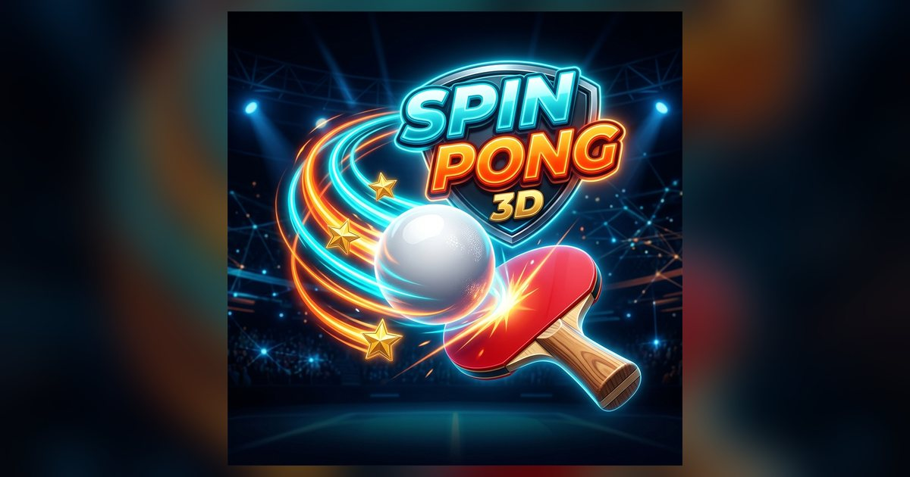

# 🏓 Spin Pong 3D

**Arcade table tennis in your browser.** Real topspin and backspin physics, three bot levels, a fast trail-survival duel mode, and peer-to-peer online matches. No install, no sign-up, no ads.

**▶ Play now: [pong-ay5.pages.dev](https://pong-ay5.pages.dev/)**



---

## Game modes

| Mode | What it is |
|---|---|
| **Classic Pong** | 3D table tennis on a regulation-size table. Serve rules, double-bounce faults, deuce and serve rotation are all enforced. Games go to 11 by default (5 or 21 in custom rooms), and you must win by 2. |
| **Curve Battle** | Top-down survival duel. Steer a line that leaves a solid trail behind it, slip through the gaps that open in trails, and box your opponent in. First to 5 rounds by default. Pick the **arena size** (Small / Medium / Large) and switch on **obstacles** (pillars and walls) and **portals** (linked pairs that teleport you, heading kept). Layouts are new every round; online, the host's settings apply. |

Both modes can be played against the bot (**Novice / Pro / Champion**) or online against another person.

## Playing online

Everything is peer-to-peer (WebRTC), so there is no game server and no account:

- **Quick Match**: joins the oldest open room for your chosen mode, or opens one and waits for a challenger.
- **Public Lobbies**: browse open rooms, or host your own with a name, mode and score target.
- **Private Room**: get a 5-letter code or invite link to send to a friend.

The host's browser referees the match (points, crashes, rounds), and the other player's game follows it, so both screens always agree on the score.

## Controls

| Action | Mouse / touchpad | Keyboard | Touch |
|---|---|---|---|
| Move paddle | Move the mouse | `A` `D` / `←` `→` (step in/out: `W` `S` / `↑` `↓`) | Slide your finger |
| Swing / serve | Click or flick | `Space` | Tap |
| Topspin | Flick up | `J` (or hold `Z` + `Space`) | Swipe up |
| Backspin slice | Flick down | `K` (or hold `X` + `Space`) | Swipe down |
| Power smash | — | `L` | — |
| Pause | ❚❚ button | `Esc` | ❚❚ button |
| **Curve Battle:** turn | — | `A` / `←`, `D` / `→` | Left / right halves of the screen |

**📱 Tilt mode (phones & tablets):** tap **Tilt** in the menu or the in-game ⚙️ settings. Tilt the device left/right to move the paddle or steer in Curve Battle; in Pong, tap, swipe or flick the phone to swing. "Level" is re-measured at every serve and round, so hold the phone however is comfortable. On iPhone, allow motion access when asked.

Paddle sensitivity can be tuned in the menu or the ⚙️ in-game settings. There is also an experimental **webcam mode** (beta) that tracks your hand: swipe up for topspin and down for slice. Video never leaves your device.

---

## Development

Requires **Node.js 18+**.

```bash
npm install
npm run dev        # http://localhost:3000 (includes a local stand-in for the presence API)
npm run build      # typecheck + production bundle in dist/
npm run preview    # serve the production build locally
```

To test multiplayer locally, open the game in two tabs of the same browser and press **Quick Match** in both with the same mode selected.

### Tech

- **TypeScript** (strict) + **Vite**, no framework
- **Three.js** for rendering, all meshes procedural
- **Custom physics**: fixed-step integrator with gravity, drag and Magnus force
- **Web Audio API**: every sound is synthesized at runtime, with no audio files
- **PeerJS / WebRTC** data channels for online play
- **[ntfy.sh](https://ntfy.sh)** public pub/sub as a free global room directory, plus a small **Cloudflare Pages Function** (`functions/api/presence.ts`) for the "players online" counter

### Project layout

```
src/
├── main.ts              Boot, WebGL check, error screen
├── core/                Game loop, Pong rules (StateMachine), Curve Battle mode, event bus
├── entities/            Table, ball, paddles, stadium & crowd, curve trails
├── controllers/         Player input, Pong AI, Curve bot, remote player, webcam tracking
├── physics/             Ball integrator, constants, trajectory prediction for the AI
├── network/             PeerJS connection, room directory, packet types
├── ui/HUD.ts            Menus, scoreboard, lobby, matchmaking
├── vfx/ audio/ utils/   Camera, particles, synthesized sound, device detection
functions/api/           Cloudflare Pages Function (presence counter)
public/                  Icons, social preview image, manifest, Cloudflare _headers
```

More background on the design is in [`docs/`](docs/).

### Deploying

The site is built for **Cloudflare Pages**: build command `npm run build`, output directory `dist`. `public/_headers` sets the security headers and Content-Security-Policy. **Any new external host (API, CDN, WebSocket) must be added to `connect-src` there**, or browsers will block it.

If you change network packet shapes or match flow, bump `PROTOCOL_VERSION` in `src/network/NetworkProtocol.ts`. Players on different versions then get a clear "refresh to update" message instead of a broken match.

## License

[MIT](LICENSE)
